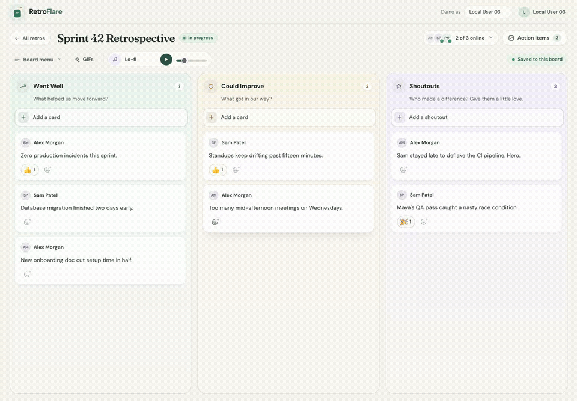
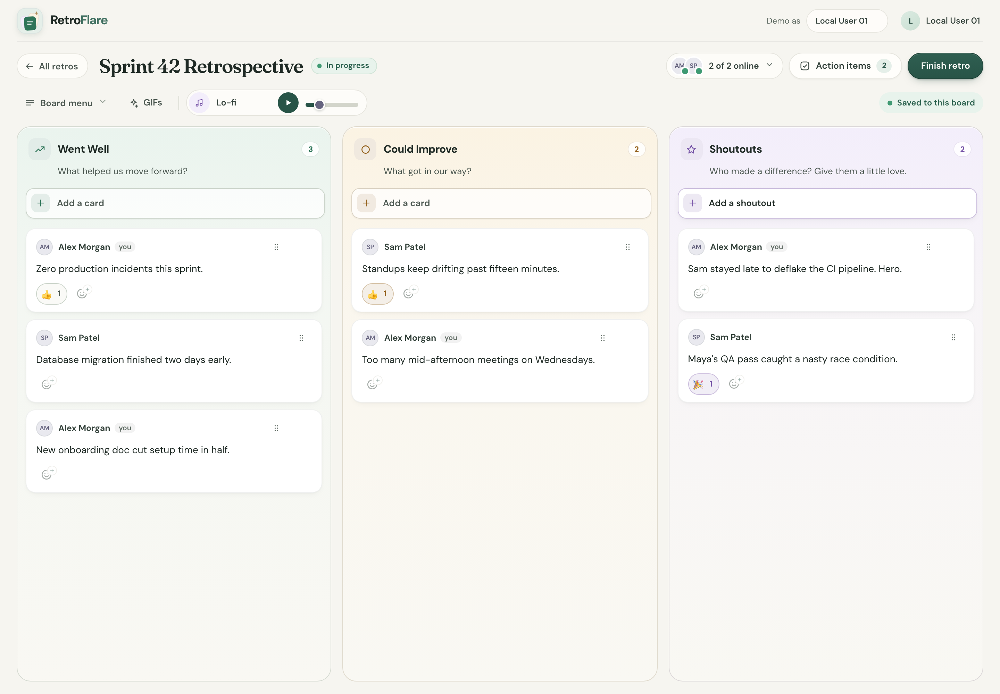
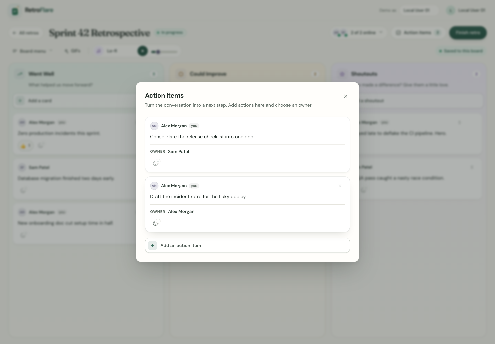

# RetroFlare

<p align="center">
  <a href="https://github.com/cquark7/RetroFlare/actions/workflows/ci.yml"></a>
  <a href="LICENSE"></a>
</p>

**A self-hosted, real-time retrospective app for teams that want to celebrate what worked, talk honestly about what didn’t, and leave with a plan.**



RetroFlare gives your team a shared board with **Went Well**, **Could Improve**, and **Shoutouts** columns. Add reactions as ideas come in, then capture next steps as owned action items. Collaborate live, finish a retro, and keep a read-only history for next time.

## What you can do

- **Reflect together:** Live boards, participant presence, and autosaved notes make it easy to contribute from separate browsers.
- **Find the signal:** React to ideas and turn the conversation into action items with owners.
- **Keep the learning:** Finish a retro to preserve its history; export and import JSON backups when you need to move or restore data.
- **Make it yours:** Optional GIF search and local, opt-in focus music. GIF search is off unless you configure a GIPHY key.
- **Run your own instance:** Deploy the app and its SQLite-backed Durable Object to your Cloudflare account; there is no RetroFlare-hosted service to depend on.

<details>
  <summary>View board and action-item screenshots</summary>
  <br>
  
  <br><br>
  
</details>

## Run locally

Requires **Node.js 22.12+** and npm.

```sh
git clone https://github.com/cquark7/RetroFlare.git
cd RetroFlare
npm ci --cache .cache/npm
npm run dev
```

Open <http://localhost:5173>. Local development uses demo identities and local Worker storage; it does not connect to a Cloudflare account. To enable GIF search during development, put `VITE_GIPHY_API_KEY=your-web-sdk-key` in an untracked `.env.local` file and restart the server. The rest of the app works without it.

## Deploy your own instance

RetroFlare runs as a Cloudflare Worker with a SQLite-backed Durable Object for shared state and WebSockets. Sign-in is handled by Cloudflare Access. A custom domain is optional; the default `workers.dev` hostname works.

1. **Choose a Worker name and hostname.** For example, `retroflare.<your-subdomain>.workers.dev`. Use a new name for a new instance; if you already run RetroFlare, keep its current Worker name to retain that instance's data.
2. **Protect the hostname with Access.** Create a hostname-based self-hosted Access application covering the full hostname, including API and WebSocket requests, and allow the intended users. Worker-level Access protection does not support WebSocket upgrades, so use hostname-based protection for this app. See [Cloudflare's Access guidance for Workers](https://developers.cloudflare.com/workers/configuration/cloudflare-access/).
3. **Create a local deployment settings file:**

   ```sh
   mkdir -p .tmp
   cp deployment.example.vars .tmp/deployment.vars
   ```

   Set the values in `.tmp/deployment.vars`:

   | Setting | What to enter |
   | --- | --- |
   | `WORKER_NAME` | The Worker name from step 1. |
   | `APP_ORIGIN` | Exact HTTPS origin, e.g. `https://retroflare.<your-subdomain>.workers.dev`, with no trailing slash. |
   | `ALLOWED_EMAIL_DOMAIN` | The email domain allowed by the Worker, such as `example.com`; configure the Access policy separately. |
   | `ACCESS_TEAM_ISSUER` | Your Zero Trust team issuer, such as `https://<team>.cloudflareaccess.com`. |
   | `ACCESS_AUD` | The Access application's [Audience (AUD) tag](https://developers.cloudflare.com/cloudflare-one/access-controls/applications/http-apps/authorization-cookie/validating-json/#get-your-aud-tag). |
   | `ADMIN_EMAILS` | Optional comma-separated addresses allowed to import backups and use administrator recovery controls. |
   | `VITE_GIPHY_API_KEY` | Optional [GIPHY Web SDK key](https://developers.giphy.com/). Leave empty to disable GIF search. This client key is included in the browser bundle; it is not a Worker secret. |

4. **Install, authenticate, and deploy:**

   ```sh
   npm ci --cache .cache/npm
   npx wrangler login
   npm run deploy
   ```

The deploy script builds and deploys the Worker; it does not create the Access application. Verify that Access covers the full hostname before inviting users. The Worker fails closed if its Access configuration is missing or invalid. Keep `.tmp/deployment.vars` and exported backups out of Git; backups may contain retrospective data.

Cloudflare's free plans may be enough for a small team, but Workers, Durable Objects, and Access have plan-specific limits that can change. Check the current [Workers limits](https://developers.cloudflare.com/workers/platform/limits/), [Durable Objects limits](https://developers.cloudflare.com/durable-objects/platform/limits/), and your account's pricing before deploying. Usage beyond included quotas may incur charges.

## Contributing

Bug reports, ideas, and pull requests are welcome. For a larger change, open an [issue](https://github.com/cquark7/RetroFlare/issues) first so we can agree on the approach. Before opening a pull request, run the same checks used in CI:

```sh
npm run typecheck
npm run lint
npm run test
npm run build
PLAYWRIGHT_BROWSERS_PATH=.cache/ms-playwright npx playwright install chromium
npm run test:e2e
```

The browser suite starts its own isolated server. See [browser test notes](tests/e2e/README.md) for coverage and local test boundaries.

## License and credits

RetroFlare is available under the [MIT License](LICENSE). Bundled fonts use the [SIL Open Font License](src/client/fonts/OFL.txt); bundled music is CC0, with sources and details in the [music credits](public/music/CREDITS.md).
